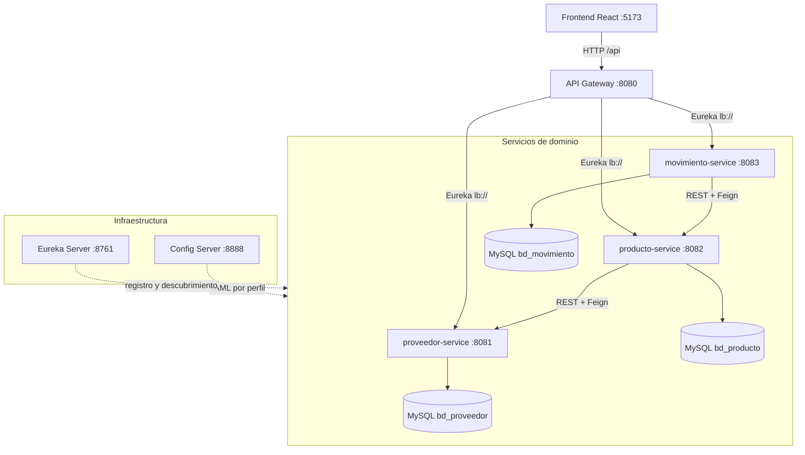

# Arquitectura del inventario

| Servicio | Puerto | Responsabilidad | Datos propios |
|---|---:|---|---|
| config-server | 8888 | YAML común y perfiles `dev`, `test`, `prod` | Ninguno |
| eureka-server | 8761 | Registro y descubrimiento | Ninguno |
| api-gateway | 8080 | Punto de entrada, rutas y CORS | Ninguno |
| proveedor-service | 8081 | CRUD y baja lógica de proveedores | `bd_proveedor` |
| producto-service | 8082 | Catálogo y validación REST del proveedor | `bd_producto` |
| movimiento-service | 8083 | Entradas, salidas, historial y stock calculado | `bd_movimiento` |
| frontend | 5173 | Panel administrativo React | Ninguno |

Las referencias entre bases son identificadores lógicos. Solo el servicio dueño consulta su base. El stock se calcula como entradas menos salidas.
